# ERIN 2.0 — FEATURE DEPENDENCY GRAPH

**Version:** 1.0
**Status:** DRAFT
**Classification:** INTERNAL — PLANNING
**Owner:** Principal Architect
**Phase:** 2 — Domain & System Architecture

---

## 1. Dependency Graph (Mermaid)

```mermaid
graph TD
    %% Foundation Layer
    INFRA[Infrastructure Setup] --> GIT[Git Repo + Monorepo]
    INFRA --> CI[CI/CD Pipeline]
    INFRA --> ECP[ECP Scripts]
    INFRA --> PRECOMMIT[Pre-commit Hooks]
    INFRA --> DOCKER[Docker Multi-stage]
    
    %% Core Data Infrastructure
    GIT --> DI01[DI-01: Provider Adapter Framework]
    DI01 --> DI02[DI-02: Instrument Master]
    DI02 --> DI03[DI-03: Ingestion Pipeline]
    DI03 --> DI04[DI-04: Data Quality Validation]
    DI04 --> DI05[DI-05: Data Provenance]
    
    %% Market Intelligence
    DI02 --> MI01[MI-01: Watchlist CRUD]
    DI03 --> MI02[MI-02: Real-time Quotes]
    DI02 --> MI03[MI-03: Market Calendar]
    MI02 --> MI04[MI-04: Basic Charting]
    
    %% Equity Research
    DI02 --> ER01[ER-01: Company Profiles]
    DI03 --> ER02[ER-02: Financial Statements]
    ER02 --> ER03[ER-03: Financial Ratios]
    
    %% Valuation Engine
    ER02 --> VE01[VE-01: DCF FCFF 2-Stage]
    ER03 --> VE02[VE-02: WACC Calculation]
    VE01 --> VE03[VE-03: DDM Models]
    
    %% Quantitative Finance
    QF01[QF-01: Distribution Library] --> QF02[QF-02: Monte Carlo Framework]
    QF02 --> QF03[QF-03: GBM Paths]
    
    %% Portfolio Management
    DI02 --> PM01[PM-01: Portfolio/Positions]
    MI02 --> PM02[PM-02: Portfolio Metrics]
    PM01 --> PM03[PM-03: Transaction Recording]
    
    %% Risk Management
    PM01 --> RM01[RM-01: Historical VaR]
    DI03 --> RM01
    QF02 --> RM02[RM-02: Parametric VaR]
    RM01 --> RM03[RM-03: Expected Shortfall]
    
    %% Fixed Income
    DI02 --> FI01[FI-01: Bond Analytics]
    DI03 --> FI02[FI-02: Yield Curve Construction]
    
    %% Derivatives
    QF01 --> DV01[DV-01: BSM European]
    QF02 --> DV02[DV-02: Binomial American]
    
    %% Macro Intelligence
    DI03 --> MAC01[MAC-01: Economic Indicators]
    DI03 --> MAC02[MAC-02: Yield Curve Snapshots]
    FI02 --> MAC02
    
    %% News Intelligence
    DI03 --> NEWS01[NEWS-01: Article Ingestion]
    DI02 --> NEWS02[NEWS-02: Entity Extraction]
    NEWS02 --> NEWS03[NEWS-03: Relevance Scoring]
    
    %% Workspace
    FW01[FW-01: Research Notebook] --> FW02[FW-02: Saved Workspaces]
    
    %% AI Intelligence
    NEWS01 --> AI01[AI-01: RAG Pipeline]
    ER02 --> AI01
    FW01 --> AI01
    AI01 --> AI02[AI-02: Tool Allowlist]
    AI02 --> AI03[AI-03: Report Generation]
    
    %% Governance
    GV01[GV-01: RBAC] --> GV02[GV-02: Audit Trail]
    GV02 --> GV03[GV-03: Data License Register]
    
    %% Terminal UI Foundation (Parallel Track)
    UI01[UI-01: Tauri + React Scaffold]
    UI01 --> UI02[UI-02: Design System]
    UI02 --> UI03[UI-03: Command Bar + Shortcuts]
    UI03 --> UI04[UI-04: Multi-panel Layout]
    UI04 --> UI05[UI-05: Watchlist Panel]
    UI05 --> UI06[UI-06: Chart Panel]
    UI06 --> UI07[UI-07: Settings/Config]
    
    %% Cross-cutting Dependencies
    UI05 --> MI01
    UI06 --> MI04
    UI03 --> GV01
    PM02 --> UI05
    RM01 --> UI06
    VE01 --> FW01
    AI01 --> FW01
```



---

## 2. Feature Dependency Table (Phase 1)

| Feature | Depends On | Blocks | Parallel Track |
|---------|------------|--------|----------------|
| **DI-01 Provider Adapter** | Infrastructure | MI-02, ER-02, MAC-01, NEWS-01 | — |
| **DI-02 Instrument Master** | DI-01 | MI-01, MI-02, ER-01, PM-01, FI-01, DV-01 | — |
| **DI-03 Ingestion Pipeline** | DI-01, DI-02 | MI-02, ER-02, MAC-01, NEWS-01, RM-01 | — |
| **DI-04 Data Quality** | DI-03 | All downstream consumers | — |
| **DI-05 Provenance** | DI-03 | Audit, Governance | — |
| **MI-01 Watchlist CRUD** | DI-02, UI-04 | MI-02 (data), PM-01 (selection) | UI-05 |
| **MI-02 Real-time Quotes** | DI-02, DI-03, UI-03 | PM-02, RM-01, UI-06 | — |
| **MI-03 Market Calendar** | DI-02 | — | — |
| **MI-04 Basic Charting** | MI-02, UI-02 | — | UI-06 |
| **ER-01 Company Profiles** | DI-02 | ER-02, VE-01 | — |
| **ER-02 Financial Statements** | DI-03, ER-01 | ER-03, VE-01, AI-01 | — |
| **ER-03 Financial Ratios** | ER-02 | VE-01, VE-02 | — |
| **VE-01 DCF** | ER-02, ER-03, QF-01 | — | FW-01 |
| **VE-02 WACC** | ER-03, QF-01 | VE-01 | — |
| **VE-03 DDM** | ER-03, QF-01 | — | — |
| **QF-01 Distributions** | — | QF-02, VE-01, VE-02, DV-01, RM-02 | — |
| **QF-02 Monte Carlo** | QF-01 | QF-03, RM-01 (MC), DV-01 (MC) | — |
| **QF-03 GBM** | QF-02 | DV-01, RM-01 | — |
| **PM-01 Portfolio/Positions** | DI-02 | PM-02, PM-03, RM-01 | — |
| **PM-02 Portfolio Metrics** | PM-01, MI-02 | RM-01 | — |
| **PM-03 Transactions** | PM-01 | — | — |
| **RM-01 Historical VaR** | PM-01, DI-03, QF-01 | RM-03 | — |
| **RM-02 Parametric VaR** | PM-01, QF-01 | RM-03 | — |
| **RM-03 Expected Shortfall** | RM-01, RM-02 | — | — |
| **FI-01 Bond Analytics** | DI-02 | FI-02 | — |
| **FI-02 Yield Curves** | DI-03, FI-01 | MAC-02, DV-01 (discounting) | — |
| **DV-01 BSM** | QF-01, QF-02, DI-02 | — | — |
| **DV-02 Binomial** | DV-01, QF-03 | — | — |
| **MAC-01 Indicators** | DI-03 | — | — |
| **MAC-02 Yield Snapshots** | DI-03, FI-02 | — | — |
| **NEWS-01 Ingestion** | DI-03 | NEWS-02, AI-01 | — |
| **NEWS-02 Entity Extraction** | NEWS-01, DI-02 | NEWS-03, AI-01 | — |
| **NEWS-03 Relevance** | NEWS-02 | AI-01 | — |
| **FW-01 Notebook** | — | FW-02, VE-01, AI-01 | — |
| **FW-02 Workspaces** | FW-01, UI-04 | — | — |
| **AI-01 RAG** | NEWS-01, ER-02, FW-01 | AI-03 | — |
| **AI-02 Tool Allowlist** | AI-01, GV-01 | AI-03 | — |
| **AI-03 Report Gen** | AI-01, AI-02, FW-01 | — | — |
| **GV-01 RBAC** | — | UI-03, AI-02 | — |
| **GV-02 Audit Trail** | GV-01 | GV-03 | — |
| **GV-03 License Register** | GV-02 | — | — |

---

## 3. Critical Path (Longest Dependency Chain)

```
INFRA → DI-01 → DI-02 → DI-03 → ER-02 → VE-01 → FW-01
                          ↘ MI-02 → PM-02 → RM-01
                          ↘ MI-02 → UI-06
                          ↘ FI-01 → FI-02 → MAC-02
                          ↘ NEWS-01 → NEWS-02 → AI-01 → AI-03
```

**Critical Path Length:** ~8 sequential steps
**Estimated Duration:** 8-10 weeks (with parallel UI track)

---

## 4. Parallelization Opportunities

| Track | Features | Can Start After |
|-------|----------|-----------------|
| **UI Foundation** | UI-01 through UI-07 | INFRA (Week 1) |
| **Data Infra** | DI-01 through DI-05 | INFRA (Week 1) |
| **Market Intel** | MI-01 through MI-04 | DI-02, DI-03, UI-04 |
| **Equity Research** | ER-01 through ER-03 | DI-02, DI-03 |
| **Quant Finance** | QF-01 through QF-03 | INFRA |
| **Valuation** | VE-01 through VE-03 | ER-02, ER-03, QF-01 |
| **Portfolio** | PM-01 through PM-03 | DI-02, MI-02 |
| **Risk** | RM-01 through RM-03 | PM-01, DI-03, QF-01 |
| **Fixed Income** | FI-01, FI-02 | DI-02, DI-03 |
| **Derivatives** | DV-01, DV-02 | QF-01, QF-02, DI-02 |
| **Macro** | MAC-01, MAC-02 | DI-03, FI-02 |
| **News** | NEWS-01 through NEWS-03 | DI-03, DI-02 |
| **Workspace** | FW-01, FW-02 | UI-04 |
| **AI** | AI-01 through AI-03 | NEWS-01, ER-02, FW-01, GV-01 |
| **Governance** | GV-01 through GV-03 | INFRA |

---

## 5. Phase 1 Sprint Plan (Indicative)

| Sprint | Focus | Deliverables |
|--------|-------|--------------|
| **1-2** | Infrastructure + Data Infra Core | Git, CI, ECP, DI-01, DI-02, DI-03 |
| **3-4** | Data Quality + UI Foundation | DI-04, DI-05, UI-01, UI-02, UI-03 |
| **5-6** | Market Intel + UI Panels | MI-01, MI-02, MI-03, MI-04, UI-04, UI-05, UI-06 |
| **7-8** | Equity Research + Quant Core | ER-01, ER-02, ER-03, QF-01, QF-02 |
| **9-10** | Valuation + Portfolio | VE-01, VE-02, VE-03, PM-01, PM-02, PM-03 |
| **11-12** | Risk + Fixed Income | RM-01, RM-02, RM-03, FI-01, FI-02 |
| **13-14** | Derivatives + Macro | DV-01, DV-02, MAC-01, MAC-02 |
| **15-16** | News + Workspace | NEWS-01, NEWS-02, NEWS-03, FW-01, FW-02 |
| **17-18** | AI + Governance | AI-01, AI-02, AI-03, GV-01, GV-02, GV-03 |
| **19-20** | Integration + Hardening | E2E tests, Security, Performance, Docs |

---

## 6. Approval

**Principal Architect:** _________________ **Date:** __________

**Chief Orchestrator:** _________________ **Date:** __________